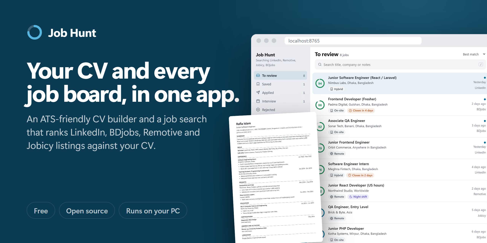
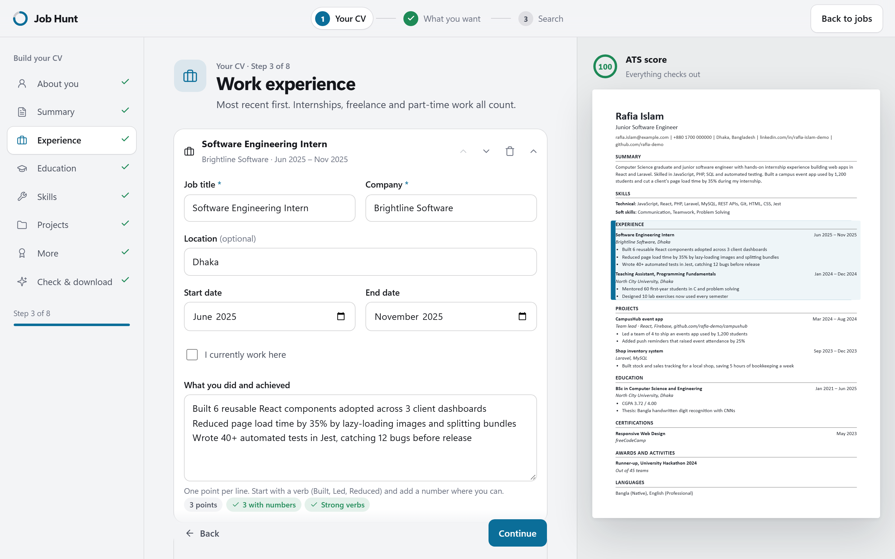
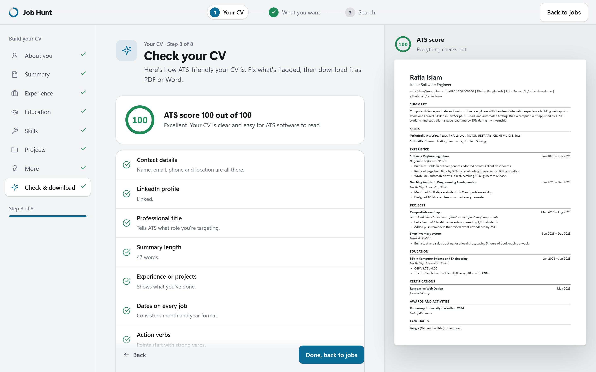
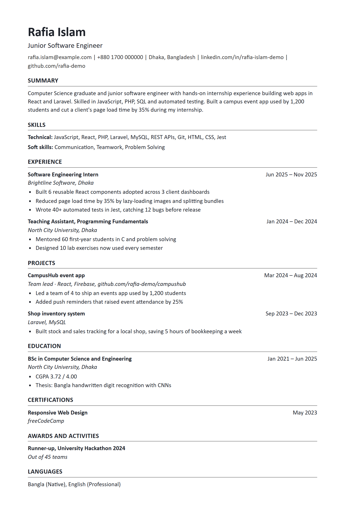
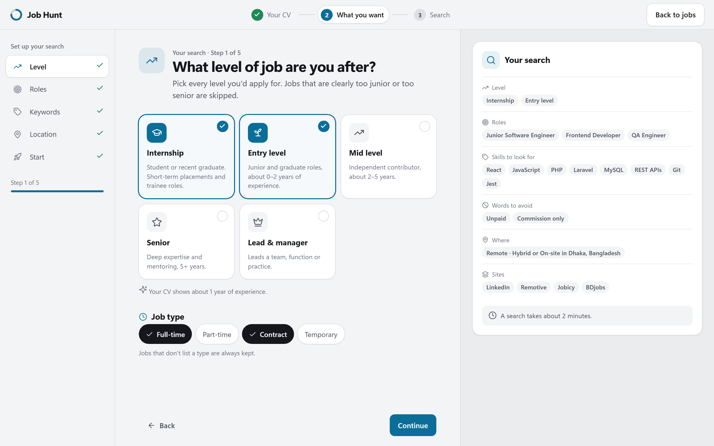
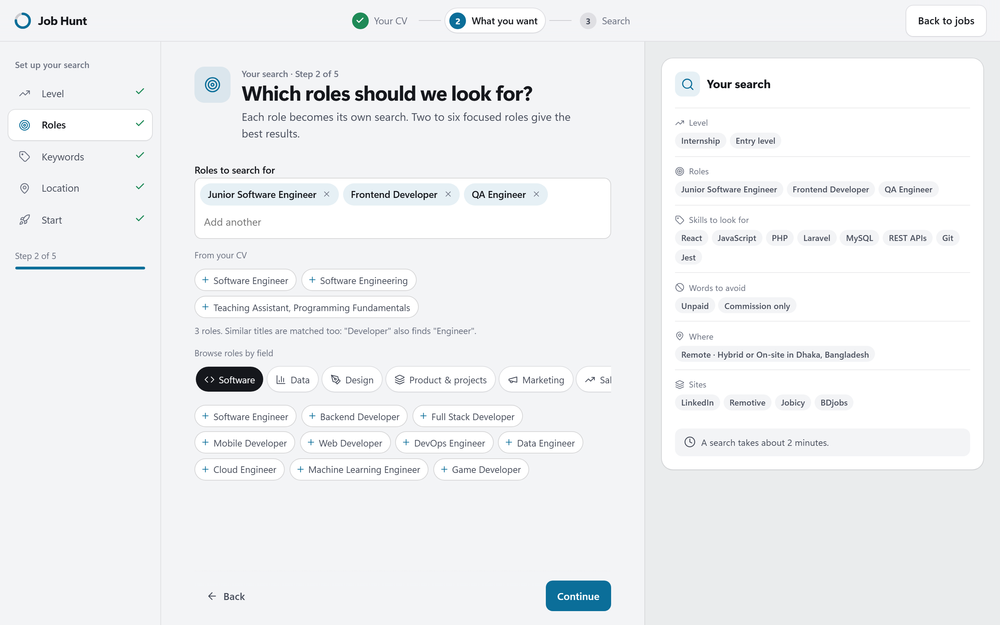
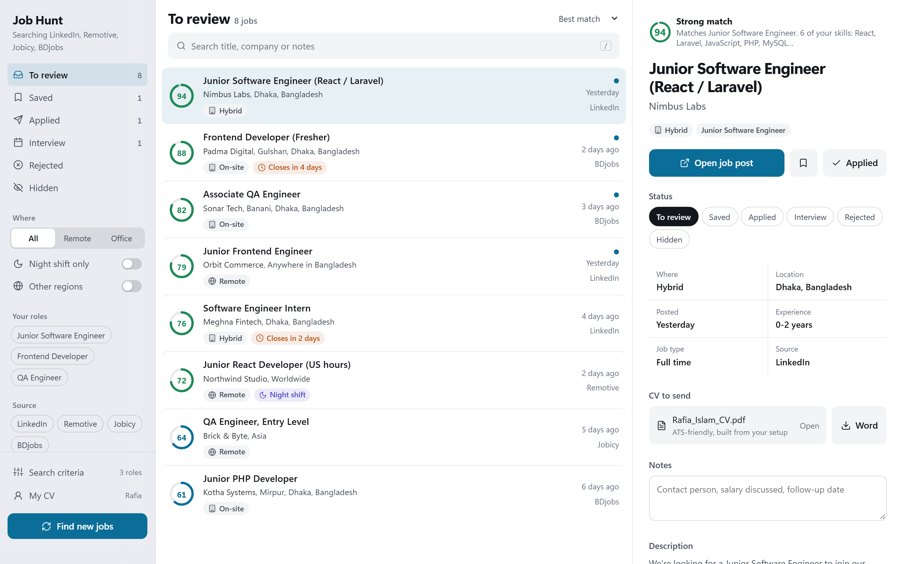
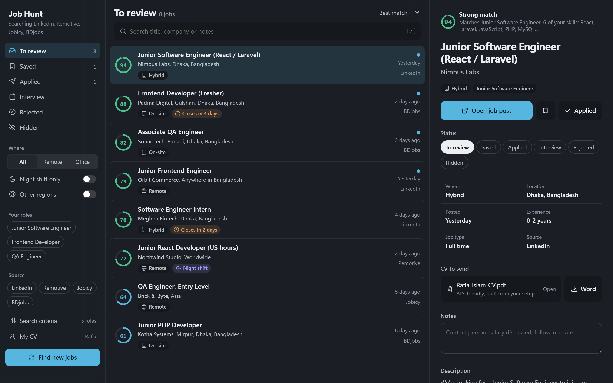
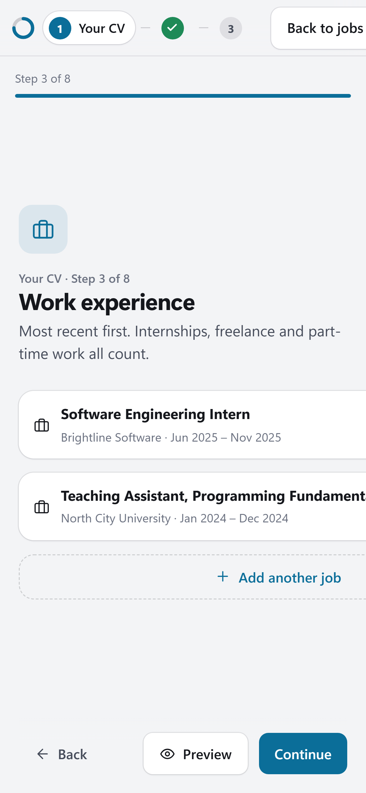
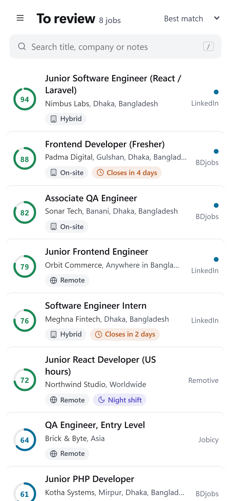

# Job Hunt

**Build an ATS-friendly CV, then see jobs from LinkedIn, BDjobs, Remotive and Jobicy in one list, ranked by how well they fit you.**

Job Hunt is for anyone looking for a job who's tired of checking the same five job sites every day.
It's especially useful for freshers and anyone who finds writing a CV hard: the CV builder walks you
through every section, scores your CV the way applicant tracking systems (ATS) read it, and tells you
exactly what to fix.

- **Free and open source** (MIT licence)
- **Runs on your own PC.** Your CV, settings and saved jobs never leave your computer.
- **No account, no sign-up, no ads**

> Screenshots use a fictional demo profile and sample job listings.

## What it does

### 1. Builds your CV, step by step

Fill in your details, experience, education, skills and projects. The page beside the form updates as
you type and highlights the section you're working on. Not sure what to write? Get a summary drafted from
your CV, pick skills from suggestions for 12 fields, and follow the tips under each box.

### 2. Checks it like an ATS would

An ATS score from 0 to 100 shows what recruiters' software will struggle with: missing contact details,
bullet points without action verbs or numbers, too few skills, missing dates. Every item has a **Fix**
button. Download the result as **PDF or Word**: one clean column, standard headings, real text.

See the generated CV

### 3. Asks what job you want

Pick your level (internship, entry, mid, senior, lead), the roles to search for, skills that matter,
words to avoid, and whether you want remote, hybrid or on-site work. It's all pre-filled from your CV, and
you can change it any time.

 

### 4. Searches every site and ranks the results

One click searches LinkedIn, BDjobs, Remotive and Jobicy. Jobs that are the wrong level, in the wrong
city, or contain words you want to avoid are skipped. Everything else gets a match score, so the best
fits come first. Open the post, save it, mark it applied, track interviews and keep notes, all in one place.

More screenshots: dark mode and phone

 

## Get started (Windows)

1. Download this project: click the green **Code** button above, then **Download ZIP**. Unzip it anywhere.
2. Double-click **Start Job Hunt.bat**.
   - The first time, it sets itself up (a minute or two). If Python isn't installed, it offers to
     install it for you, or opens the download page.
   - Your browser opens at http://localhost:8765. Keep the black window open while you use the app.
3. Build your CV, choose what you want, and press **Start job search**.

Change your CV or search criteria any time from **My CV** and **Search criteria** at the bottom of the
dashboard sidebar. Press **Find new jobs** to search again; jobs you've already seen are remembered.

On macOS or Linux: install Python 3.10+, then run
`python3 -m venv .venv && .venv/bin/pip install -r requirements.txt && .venv/bin/python -m jobhunt.server`.

## Job sites

| Site | Covers |
| --- | --- |
| LinkedIn | Every country. Remote, hybrid and on-site. Uses the public job search, never your account. |
| BDjobs | Bangladesh (turned on when your country is Bangladesh) |
| Remotive | Remote jobs worldwide |
| Jobicy | Remote jobs worldwide |

## How matching works

- A job's title must match one of your roles. Similar words count: "Developer" also finds "Engineer".
- Titles that show the wrong level (for example "Senior" when you picked Entry) are skipped, as are
  jobs asking for far more years of experience than your levels.
- Jobs with any of your "words to avoid" in the title are skipped.
- On-site and hybrid jobs must be in your city, or anywhere in your country if you leave the city empty.
  Remote jobs limited to other countries are kept but hidden behind the **Other regions** switch.
- The score (0 to 100) rises with the role match, how many of your skills the job mentions, a clear level
  fit, and whether you're eligible to apply.

## Your data

Everything you enter is stored in the `data` folder next to the app:

- `profile.json`: your CV
- `criteria.json`: your search settings
- `jobs.db`: jobs found, plus your statuses and notes

Nothing is uploaded anywhere. The only outside traffic is the job searches themselves. Delete the `data`
folder to start over.

To give the app to a friend, double-click **Make Shareable Copy.bat**. It creates `Job Hunt.zip` on your
Desktop **without** your CV, settings or saved jobs.

## Contributing

Issues and pull requests are welcome, especially new job sites.

- `jobhunt/server.py`: local web server and API (`python -m jobhunt.server`)
- `jobhunt/static/setup.html`: CV builder and search setup; `jobhunt/static/index.html`: the dashboard
- `jobhunt/cv.py`: PDF and Word CV output
- `jobhunt/matcher.py`: filtering and scoring from `criteria.json`
- `jobhunt/sources/`: one module per job site. Add a site by writing
  `fetch(criteria, matcher, log, is_known)` and registering it in `jobhunt/scrape.py` and `jobhunt/store.py`.
- Search from the command line: `.venv\Scripts\python -m jobhunt.scrape`. Re-apply the criteria to stored
  jobs: `.venv\Scripts\python -m jobhunt.scrape rescore`.

Please respect each job site's terms and keep request rates low; the built-in delays are there on purpose.

## Licence

[MIT](LICENSE)
